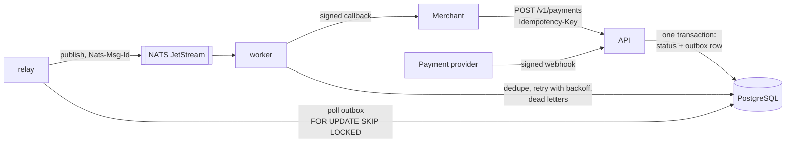

# payhook

A payments service in Go that takes payment requests from merchants, receives signed status webhooks from payment providers, and notifies merchants reliably — built around the failure cases that make payment integrations hard: retries, duplicates, out-of-order events and crashes between steps.




Three binaries from one codebase: **api** (REST + webhooks), **relay** (outbox → NATS), **worker** (NATS → merchant callbacks). Each exposes Prometheus metrics on its own port (`METRICS_ADDR`, default `:9100` / `:9101` / `:9102`), separate from the public API. Runs with Docker Compose, on Kubernetes (Helm chart), and on AWS ([payhook-infra](https://github.com/unsound-mint/payhook-infra), Terraform).

## What it handles

| Problem | How |
|---|---|
| Merchant retries `POST /payments` after a timeout | `Idempotency-Key` + unique `(merchant_id, idempotency_key)`. Same key and body → the original payment (200). Same key, different body → 422. |
| Provider delivers the same webhook twice, or 30 times at once | Primary key on `(provider, event_id)` inside the same transaction as the status change; the payment row is locked `FOR UPDATE`. Tested with 30 concurrent deliveries, duplicates of one `succeeded` event racing `failed` events → exactly one status change, one outbox row. |
| Webhooks arrive out of order (`failed` after `succeeded`) | Explicit state machine (`pending → succeeded/failed/canceled`, `succeeded → refunded`). Invalid transitions are recorded and acknowledged with 200, so the provider stops retrying, but never applied. |
| Forged or replayed webhooks | HMAC-SHA256 over `timestamp.body`, constant-time comparison, 5-minute tolerance window. |
| Crash between "update DB" and "publish event" | Transactional outbox: the event is written in the same transaction as the change; the relay publishes it afterwards. Several relays can run in parallel (`SKIP LOCKED`). |
| Relay publishes but crashes before marking the row | JetStream dedupe window keyed on the outbox id (`Nats-Msg-Id`), plus consumer-side dedupe. |
| Merchant endpoint is down | Retries with growing delays (1s, 5s, 30s, 2m, 10m) via `NakWithDelay`; after the last attempt the message goes to `dead_letters` instead of retrying forever. Callbacks are signed so merchants can verify them. |
| Merchant points `callback_url` at our internal network (SSRF) | `https` only, no literal internal IPs or `localhost` at creation; at connect time the resolved IP is checked again (loopback, private, link-local/metadata, CGNAT are refused), redirects are not followed, no proxy from the environment. `PAYHOOK_ALLOW_PRIVATE_CALLBACKS=true` lifts this for local runs and tests. |
| Deploys | Graceful shutdown (in-flight HTTP requests and messages finish), `/healthz` and `/readyz`, migrations guarded by an advisory lock so replicas can start together. |

## Run it

```sh
docker compose up -d --build          # postgres, nats, api, relay, worker, prometheus
make demo                             # create a payment, send a signed webhook, read it back
```

If port 8080 is taken: `API_PORT=18080 docker compose up -d` and `make demo API_PORT=18080`.

```sh
# create a payment (amount in minor units)
curl -X POST localhost:8080/v1/payments \
  -H 'Idempotency-Key: order-42' \
  -d '{"merchant_id":"shop-1","amount":1500000,"currency":"KZT","callback_url":"https://example.com/hook"}'

# simulate the provider
go run ./cmd/sendwebhook -payment <id> -type payment.succeeded
```

Prometheus is on `localhost:9090`; useful series: `payhook_webhooks_total` by outcome, `payhook_outbox_backlog`, `payhook_notifier_deliveries_total` by result, `payhook_http_request_duration_seconds` per route.

## Kubernetes

`deploy/helm/payhook` is a Helm chart with one Deployment per component (same image, different command):

- readiness and liveness probes, `preStop` sleep and graceful shutdown, `maxUnavailable: 0` rolling updates;
- HPA for the API, PodDisruptionBudget, topology spread across nodes;
- non-root, read-only root filesystem, all capabilities dropped, seccomp `RuntimeDefault`;
- secrets from the chart or an `existingSecret` (e.g. synced from AWS Secrets Manager); pods roll automatically when the chart-managed secret changes, while changes to an `existingSecret` need a restart (or a reloader);
- optional Ingress and Prometheus Operator `ServiceMonitor`;
- `helm test` smoke test.

```sh
deploy/kind/up.sh     # kind cluster + NATS (official chart) + Postgres + payhook, then helm test
deploy/kind/down.sh
```

CI runs the same script on every push. Rolling restart of the API under constant load (a client inside the cluster creating payments for 45 s while every API pod was replaced): **5,924 requests, 0 failed**.

## Tests

```sh
make test     # unit + end-to-end, race detector on
```

The end-to-end tests start real PostgreSQL and NATS with testcontainers and run the API, relay and worker together:

- full lifecycle: idempotent create, webhook applied, redelivery ignored, out-of-order event rejected, merchant callback that fails once and then succeeds — exactly one accepted callback;
- 30 concurrent webhooks for one payment, redeliveries of one `succeeded` event racing distinct `failed` events → exactly one status change, the payment ends in the winner's status, one outbox row;
- 20 concurrent creates with the same idempotency key → one payment, one 201;
- a merchant that never accepts → one dead letter after the last attempt, also when the first dead-letter write fails;
- shutdown during a callback → the callback completes and is recorded before the worker exits;
- an outbox row that isn't a valid event is set aside without blocking the rows behind it;
- bad signature → 401.

## Load test

`loadtest/payments.js` (k6): 200 iterations/s for 30 seconds, each a payment creation with a new idempotency key plus a read of it; ~2% of iterations instead resend the VU's last request and must get the original payment back (200).

```sh
k6 run loadtest/payments.js
# without k6 installed:
docker run --rm -i --network host grafana/k6:1.3.0 run - < loadtest/payments.js
```

On a laptop with everything in Docker Compose (2026-10-29): 12,002 requests, 0 errors, 139 replays (2.3%), p95 3.3 ms for creates.

## Layout

```
cmd/api, cmd/relay, cmd/worker   entry points
cmd/sendwebhook                  signed test webhooks
internal/payment                 domain, state machine, PostgreSQL store
internal/webhook                 HMAC signing and verification
internal/outbox                  outbox relay
internal/notifier                consumer, retries, dead letters
internal/broker                  JetStream setup and publishing
internal/httpapi                 routes, handlers, metrics middleware
internal/db                      pool and embedded migrations
e2e                              testcontainers end-to-end tests
deploy/helm/payhook              Helm chart
deploy/kind                      local Kubernetes setup (also used in CI)
```

## Known limitations

- Event order is not guaranteed end to end. The relay publishes in outbox order, but parallel relays, broker redeliveries and callback retries can deliver a later event before an earlier one. Merchants should compare event `id`s (numeric strings) per payment (status changes of one payment are serialised, so its ids increase in order) or `occurred_at`, and treat the payment's current status as the source of truth.

## Trade-offs and next steps

- The relay polls every 200 ms. `LISTEN/NOTIFY` or logical replication (Debezium) would cut latency; polling is simpler and good enough here.
- Delivery to merchants is at least once; merchants dedupe on the event `id`.
- One shared callback secret; per-merchant secrets and a merchants table are the obvious next step.
- No authentication on the merchant API yet (would be API keys per merchant).
